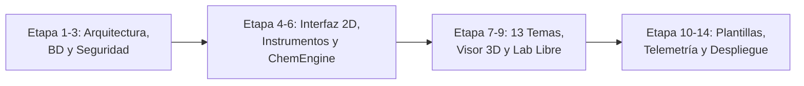

# 🧪 Laboratorio Virtual Integral de Química

**Plataforma web educativa para el aprendizaje interactivo de química mediante simulaciones científicas, experimentos virtuales y modelado molecular 2D/3D.**

<p align="center">
  
  
  
  
  
</p>

---

## 📖 1. Descripción del proyecto

El **Laboratorio Virtual Integral de Química** es una plataforma web educativa diseñada para el **Colegio Alexander Fleming**, cuyo propósito es ofrecer un entorno digital donde los estudiantes puedan aprender, experimentar y comprender los conceptos fundamentales de química mediante herramientas interactivas, simulaciones científicas y modelado molecular 2D/3D.

La plataforma busca proporcionar una alternativa educativa ante la falta de equipamiento o reactivos de un laboratorio físico, permitiendo que los estudiantes realicen experimentos virtuales, manipulen instrumentos, utilicen sustancias simuladas, observen reacciones químicas y construyan modelos atómicos y moleculares.

El sistema sintetiza y supera las principales capacidades de cuatro referentes internacionales:
- **ChemCollective Virtual Lab:** Manipulación de recipientes, cristalería, preparación de disoluciones, mezclas, reacciones y titulaciones analíticas.
- **PhET Interactive Simulations:** Dinámica conceptual de átomos, estados de la materia, densidad, concentración, pH y leyes cinéticas.
- **MolView:** Construcción de estructuras moleculares, editor químico 2D, visualización 3D y química orgánica.
- **Avogadro:** Modelado molecular 3D, edición espacial de átomos/enlaces y geometría tridimensional.

> **Finalidad central:** El estudiante no tiene que utilizar programas externos dispersos, sino que puede desarrollar todas sus actividades académicas desde un único laboratorio virtual unificado, seguro y accesible.

---

## 🎯 2. Objetivos del sistema

### Objetivo general
Desarrollar y desplegar una plataforma web de laboratorio virtual integral que facilite el aprendizaje de química mediante simulaciones interactivas reactivas en el cliente, modelado molecular 2D/3D, evaluación procedimental basada en telemetría y gestión docente simplificada por plantillas.

### Objetivos específicos
- Facilitar el aprendizaje de los 13 temas de química escolar mediante 3 motores interactivos especializados.
- Proporcionar instrumentos y sustancias químicas virtuales con comportamiento fisicoquímico realista.
- Permitir la realización de experimentos en un **Laboratorio Libre** delimitado por subsistemas termodinámicos coherentes.
- Implementar un constructor de átomos y moléculas en 2D y 3D utilizando librerías quimioinformáticas abiertas (**3Dmol.js / PubChem API**).
- Permitir que los docentes diseñen prácticas y exámenes en menos de 5 minutos mediante un **Asistente de Plantillas Paramétricas** (sin necesidad de programar).
- Registrar la telemetría procedimental del estudiante (orden de pasos, purga de instrumental, tiempos y virajes) en formato `JSONB`.
- Evaluar competencias científicas integrales (técnica experimental, exactitud cuantitativa y fundamentación teórica).
- Garantizar la continuidad del aprendizaje ante microcortes de red mediante persistencia local offline (PWA / Storage).
- Fomentar la cultura de bioseguridad escolar mediante el Sistema Globalmente Armonizado (SGA) y el error formativo seguro.

---

## 🧬 3. Temario curricular de química (13 Unidades)

El sistema cubre íntegramente las 13 unidades académicas del plan de estudios escolar:

| N.º | Tema | Contenidos principales | Enfoque didáctico y motor |
|:---:|---|---|---|
| **01** | Química y magnitudes | Ramas de la química, Sistema Internacional, análisis dimensional y conversiones | Módulo de medición, balanza y probeta |
| **02** | Materia | Estados físicos de la materia, cambios de estado y teoría cinético-molecular | Simulación cinética de partículas 2D |
| **03** | Clasificación de la materia | Sustancias puras (elementos/compuestos), mezclas homogéneas/heterogéneas y métodos de separación | Mesa 2D de separación y filtrado |
| **04** | Estructura atómica | Modelos atómicos (Dalton, Thomson, Rutherford, Bohr), partículas subatómicas, isótopos e iones | Constructor atómico interactivo |
| **05** | Zona extranuclear | Orbitales $s, p, d, f$, números cuánticos ($n, l, m_l, m_s$), principio de Aufbau y regla de Hund | Diagramas de Moeller y configuración electrónica |
| **06** | Tabla periódica | Grupos, periodos, bloques y propiedades periódicas (electronegatividad, radio atómico, afinidad, ionización) | Tabla interactiva con gradientes visuales |
| **07** | Enlace químico | Enlaces iónicos, covalentes (polar/apolar) y metálicos, electrones de valencia y estructuras de Lewis | Constructor de enlaces y mapa de cargas |
| **08** | Funciones inorgánicas | Óxidos, hidróxidos, hidrácidos, oxácidos y sales. Nomenclatura tradicional, Stock y IUPAC | Validador sintáctico y formulador químico |
| **09** | Reacciones químicas | Tipos (síntesis, descomposición, desplazamiento simple/doble) y balanceo por tanteo y redox | Simulador reaccional con fenomenología visual |
| **10** | Estequiometría | Mol, masa molar, número de Avogadro, reactivo limitante, reactivo en exceso y rendimiento | Balanza virtual y cálculo cuantitativo |
| **11** | Disoluciones y pH | Concentración (Molaridad), escala de pH, neutralización, indicadores (fenolftaleína) y titulación | Mesa volumétrica con bureta y `ChemEngine.js` |
| **12** | Química del carbono | Tetravalencia, concatenación, hibridación ($sp^3, sp^2, sp$) y enlaces sigma ($\sigma$) / pi ($\pi$) | Visor molecular 3D con orbitales híbridos |
| **13** | Química orgánica | Hidrocarburos (alcanos, alquenos, alquinos) y grupos funcionales (alcoholes, aldehídos, cetonas, ácidos, ésteres) | Modelador molecular tridimensional |

---

## 🧪 4. Módulos del laboratorio virtual

El sistema articula 12 módulos principales que cubren las 13 unidades académicas:

- **4.1. Materia y medición:** Balanza digital virtual, probeta graduada, termómetro, medición de masa/volumen, cálculo de densidad y conversión de unidades.
- **4.2. Estados de la materia:** Simulación de partículas en sólidos, líquidos y gases, control de temperatura, fusión, solidificación, vaporización, condensación y sublimación.
- **4.3. Separación de mezclas:** Filtración con papel filtro, decantación, destilación simple, centrifugación, evaporación e identificación de mezclas homogéneas y heterogéneas.
- **4.4. Constructor de átomos:** Incorporación de protones, neutrones y electrones, cálculo de número atómico ($Z$), número de masa ($A$), isótopos y representación de modelos atómicos.
- **4.5. Configuración electrónica:** Visualización de orbitales $s, p, d, f$, números cuánticos, principio de Aufbau, regla de Hund, principio de exclusión de Pauli y distribución electrónica por niveles y subniveles.
- **4.6. Tabla periódica interactiva:** Consulta de elementos químicos, número atómico, masa atómica, símbolo, configuración electrónica, grupos, periodos, electronegatividad, radio atómico y energía de ionización.
- **4.7. Constructor de moléculas y enlaces:** Estructuras de Lewis, enlaces iónicos, covalentes y metálicos, electrones de valencia, polaridad molecular y construcción de geometrías.
- **4.8. Formulación y nomenclatura:** Óxidos, hidróxidos, ácidos, sales e hidruros en nomenclatura tradicional, Stock y IUPAC.
- **4.9. Reacciones químicas:** Reacciones de síntesis, descomposición, desplazamiento simple y doble desplazamiento, balanceo por tanteo y método redox.
- **4.10. Estequiometría:** Masa molar, número de Avogadro, cálculo de moles, conversión masa-mol, reactivo limitante, reactivo en exceso y rendimiento porcentual.
- **4.11. Disoluciones, ácidos y bases:** Preparación de disoluciones acuosas, cálculo de molaridad y concentración, escala de pH, neutralización ácido-base, indicadores de pH y titulación volumétrica.
- **4.12. Química orgánica:** Tetravalencia e hibridación del carbono ($sp^3, sp^2, sp$), enlaces sigma y pi, alcanos, alquenos, alquinos, alcoholes, aldehídos, cetonas, ácidos carboxílicos y ésteres.

---

## 🔬 5. Simuladores de referencia y su integración funcional

El proyecto toma como referencia cuatro plataformas científicas e integra sus capacidades dentro de una única plataforma web:

| Plataforma de referencia | Sitio oficial | Funcionalidades integradas en este laboratorio |
|---|---|---|
| **ChemCollective Virtual Lab** | [chemcollective.org/vlabs](https://chemcollective.org/vlabs) | Entorno experimental, selección de reactivos, manipulación de matraces/pipetas/buretas, disoluciones y titulaciones. |
| **PhET Interactive Simulations** | [phet.colorado.edu](https://phet.colorado.edu/es/simulations/filter?subjects=chemistry) | Simulaciones interactivas conceptuales de átomos, partículas cinéticas, estados de la materia, densidad y balanceo. |
| **MolView** | [molview.org](https://molview.org/) | Editor químico 2D, visualización molecular 3D, representación de enlaces y química orgánica. |
| **Avogadro** | [avogadro.cc](https://avogadro.cc/) | Modelado molecular 3D, edición espacial de átomos/enlaces y conformaciones geométricas tridimensionales. |

---

## ⚠️ 6. Análisis de problemas detectados y soluciones de ingeniería

Durante la auditoría del proyecto inicial se identificaron cuellos de botella técnicos y pedagógicos críticos, los cuales fueron resueltos mediante la siguiente arquitectura:

```
┌───────────────────────────────────────┬─────────────────────────────────────────────────────────────┐
│ Problema Detectado (Riesgo Crítico)  │ Solución Técnica y Pedagógica Aplicada                      │
├───────────────────────────────────────┼─────────────────────────────────────────────────────────────┤
│ 1. Sobrecarga del servidor por        │ Motor químico reactivo en cliente (ChemEngine.js):          │
│    cálculos químicos continuos en     │ Cálculos de pH, equilibrio y masa en memoria local del      │
│    Spring Boot (latencia en vertidos).│ navegador a 60 FPS con cero latencia de red.                │
├───────────────────────────────────────┼─────────────────────────────────────────────────────────────┤
│ 2. Complejidad excesiva de programar  │ Integración de 3Dmol.js y PubChem API:                      │
│    modelado molecular 3D en Three.js  │ Renderizado quimioinformático acelerado por WebGL con       │
│    desde cero.                        │ ángulos de enlace e hibridaciones reales.                   │
├───────────────────────────────────────┼─────────────────────────────────────────────────────────────┤
│ 3. Constructor docente libre inviable │ Asistente de Prácticas por Plantillas Paramétricas:         │
│    de programar y usar para profesores│ El profesor configura prácticas en < 5 min mediante         │
│    que no son programadores.          │ 4 plantillas con reactivos aleatorios contra copias.        │
├───────────────────────────────────────┼─────────────────────────────────────────────────────────────┤
│ 4. Evaluación superficial que solo    │ Rúbrica Procedimental con Telemetría JSONB:                 │
│    mide el resultado final sin técnica│ Registro inmutable de purga, menisco, orden de vertido y    │
│    experimental.                      │ viraje de indicador, con retroalimentación cualitativa.     │
├───────────────────────────────────────┼─────────────────────────────────────────────────────────────┤
│ 5. Riesgo de caída de simulaciones por│ Soporte Offline PWA con IndexedDB:                          │
│    microcortes de Wi-Fi escolar.      │ Persistencia local continua y sincronización automática.    │
└───────────────────────────────────────┴─────────────────────────────────────────────────────────────┘
```

---

## 🏛️ 7. Dictamen oficial de aprobación pedagógica

El proyecto cuenta con la auditoría y aprobación formal del **Comité Curricular de Ciencias y Laboratorio** (`agenteDocente`):

```
ESTADO DEL DICTAMEN: APROBADO CON ALTA DISTINCIÓN PEDAGÓGICA
- Criterio 1 (Secuencia Curricular): CUMPLE (Progresión epistemológica del Triángulo de Johnstone).
- Criterio 2 (Rigor Químico): CUMPLE (Neutralización estequiométrica, Henderson-Hasselbalch y viraje real 8.2 - 10.0).
- Criterio 3 (Carga Docente): CUMPLE (Generador de prácticas por plantillas paramétricas en < 5 minutos).
- Criterio 4 (Evaluación Formativa): CUMPLE (Rúbrica vigesimal 0-20 respaldada por auditoría de telemetría JSONB).
- Criterio 5 (Bioseguridad): CUMPLE (Pictogramas SGA y principio de error formativo seguro).
```

---

## 🧰 8. Biblioteca de instrumentos virtuales

El laboratorio cuenta con una biblioteca de instrumentos interactivos reutilizables:

| Instrumento | Clasificación | Funcionalidad interactiva y medición |
|---|---|---|
| **Vaso de precipitados (250 mL)** | Contención | Preparación de disoluciones, disolución de solutos y mezclas |
| **Probeta graduada (100 mL)** | Medición general | Medición rápida de líquidos y cálculo de volumen por desplazamiento de sólidos |
| **Matraz Erlenmeyer (250 mL)** | Reacción y titulación | Agitación rotatoria, contención de alícuotas y observación de viraje de color |
| **Tubos de ensayo y gradilla** | Pequeña escala | Reacciones preliminares con reactivos en pequeña escala |
| **Pipeta volumétrica / graduada** | Transferencia | Extracción y vertido de alícuotas con propipeta virtual de seguridad |
| **Bureta graduada (50 mL)** | Volumétrico de precisión | Dosificación regulable gota a gota con llave de paso y zoom al menisco |
| **Balanza analítica digital** | Gravimétrico | Medición de masa con función de tarado y precisión de $\pm 0.01\text{ g}$ |
| **Termómetro digital** | Medición física | Registro continuo de temperatura en procesos exotérmicos y endotérmicos |
| **pH-metro y tiras reactivas** | Análisis químico | Medición continua de pH y lectura de viraje colorimétrico |
| **Mechero Bunsen** | Calentamiento | Suministro de calor virtual con control de llama y advertencias de seguridad |
| **Embudo con papel filtro** | Separación | Separación de sólidos insolubles por filtración gravitatoria |
| **Equipo de destilación simple** | Separación | Separación de componentes de mezclas líquidas por punto de ebullición |
| **Centrífuga de laboratorio** | Separación | Separación acelerada de fases por densidad |
| **Mortero y pistilo** | Mecánico | Simulación de pulverización y trituración de reactivos sólidos |

---

## ⚗️ 9. Biblioteca de sustancias y seguridad (SGA)

Cada reactivo incluye su **Ficha de Datos de Seguridad (FDS)** interactiva y pictogramas oficiales del Sistema Globalmente Armonizado:

- **Agua destilada ($H_2O$):** Solvente universal neutro.
- **Cloruro de sodio ($NaCl$):** Sal neutra para curvas de solubilidad.
- **Azúcar ($C_{12}H_{22}O_{11}$):** Soluto orgánico para soluciones y saturación.
- **Arena (representación de $SiO_2$):** Sólido insoluble para prácticas de filtración y mezclas heterogéneas.
- **Aceite vegetal:** Líquido inmiscible para prácticas de densidad y decantación.
- **Alcohol etílico ($C_2H_5OH$):** Solvente inflamable para mezclas homogéneas y destilación. *(Inflamable)*
- **Vinagre (disolución de $CH_3COOH$):** Ácido débil para titulaciones y equilibrio químico buffer. *(Atención)*
- **Bicarbonato de sodio ($NaHCO_3$):** Sal básica para reacciones de efervescencia con desprendimiento de $CO_2$.
- **Ácido clorhídrico ($HCl$, 0.1 M - 1.0 M simulado):** Ácido fuerte para neutralizaciones. *(Corrosivo)*
- **Hidróxido de sodio ($NaOH$, 0.1 M - 1.0 M simulado):** Base fuerte para titulaciones. *(Corrosivo)*
- **Fenolftaleína:** Indicador ácido-base con viraje gradual de incoloro a rosa fucsia (pH 8.2 - 10.0).
- **Sulfato de cobre pentahidratado ($CuSO_4 \cdot 5H_2O$ simulado):** Sal azul para reacciones de precipitación. *(Atención)*

---

## 🧑‍🔬 10. Modalidades pedagógicas de aprendizaje

### 10.1. Laboratorio libre (Sandbox delimitado por dominios)
Espacio de exploración sin tiempo límite ni calificación obligatoria. Para evitar inconsistencias científicas, el alumno opera dentro de dominios termodinámicos coherentes (*Sandbox Ácido-Base*, *Sandbox Solubilidad*, *Sandbox Densidad*).

### 10.2. Biblioteca de experimentos guiados
Prácticas formativas voluntarias paso a paso con catálogo de experimentos, objetivos de aprendizaje, instrumentos, sustancias requeridas, explicaciones científicas y retroalimentación interactiva.

### 10.3. Prácticas y exámenes asignados
Evaluaciones formales configuradas por la docente con restricciones de instrumentos autorizados, sustancias permitidas, cantidades, tiempo límite, registro de telemetría y calificación automática.

---

## 👩‍🏫 11. Constructor de prácticas para docentes

El docente dispone de un **Asistente de Plantillas Paramétricas** que le permite generar actividades sin necesidad de programar:

1. **Selección de plantilla base:**
   - *Plantilla 1:* Titulación ácido-base y curvas de neutralización.
   - *Plantilla 2:* Determinación de densidad de sólidos desconocidos (Arquímedes).
   - *Plantilla 3:* Separación de mezclas y filtración.
   - *Plantilla 4:* Construcción y geometría molecular de hidrocarburos.
2. **Configuración de parámetros:**
   - Selección de reactivos y concentraciones (con opción de generar valores aleatorios para evitar copias).
   - Tolerancia de error aceptada ($\pm 2\%$ a $\pm 5\%$).
   - Tiempo de ejecución y cuestionario de preguntas cuantitativas / teóricas.
3. **Publicación y revisión:**
   - Asignación a estudiantes o secciones y consulta de reportes analíticos con retroalimentación automática.

---

## 📊 12. Rúbrica formativa y evaluación procedimental (Escala 0 - 20)

El sistema evalúa tanto el procedimiento experimental como los resultados cuantitativos:

| Criterio | Puntaje | Indicador evaluado mediante telemetría `JSONB` |
|---|:---:|---|
| **Selección de instrumentos y bioseguridad** | **3 pts** | Elección adecuada de cristalería, lectura de ficha SGA y no calentamiento de material aforado. |
| **Procedimiento experimental y técnica** | **5 pts** | Purga de la bureta, orden de vertido y dosificación gota a gota en el punto de equivalencia. |
| **Mediciones y toma de datos** | **4 pts** | Lectura precisa de menisco en probeta/bureta y tarado correcto de la balanza analítica. |
| **Resultados y estequiometría** | **5 pts** | Precisión matemática en la concentración, densidad o reactivo limitante calculado. |
| **Conocimiento científico** | **3 pts** | Balanceo de la ecuación química y cuestionario teórico de fundamentación. |
| **Total** | **20 pts** | **Calificación vigesimal oficial escolar.** |

---

## 👥 13. Roles del sistema

- **Administrador:** Gestionar usuarios, docentes y estudiantes, administrar cursos, permisos, catálogo de reactivos/instrumentos y supervisar la infraestructura.
- **Docente:** Crear prácticas y exámenes mediante plantillas, configurar escenarios, asignar actividades, supervisar desempeño, revisar procedimientos y generar reportes.
- **Estudiante:** Acceder al laboratorio libre, consultar guías formativas, construir modelos moleculares, realizar prácticas evaluadas, rendir exámenes y consultar su historial formativo.

---

## 🏗️ 14. Arquitectura tecnológica del sistema

Diseño desacoplado **Edge-Client + API REST Stateless**:

### Backend
- **Lenguaje y framework:** Java 17 LTS, Spring Boot 3.x, Spring Security (JWT Stateless), Spring Data JPA.
- **Herramienta de construcción:** Apache Maven.
- **Responsabilidades:** Autenticación, gestión de cursos y plantillas, procesamiento de telemetría (`GradingService`), generación de retroalimentación cualitativa y persistencia de resultados.

### Frontend
- **Tecnologías:** HTML5, CSS3 (Tailwind CSS), JavaScript modular.
- **Motor 2D (Mesa de cristalería):** Canvas API / PixiJS (acelerado por hardware, óptimo a 60 FPS).
- **Visor 3D (Quimioinformática):** `3Dmol.js` y conexión REST a PubChem.
- **Motor químico:** `ChemEngine.js` en memoria del navegador.
- **Persistencia local:** IndexedDB (PWA) con tolerancia a microcortes de red.

### Base de datos
- **PostgreSQL 15+:** Almacenamiento de usuarios, roles, cursos, temas, instrumentos, sustancias, asignaciones, calificaciones y la columna documental `JSONB` (`telemetry_log`) indexada con GIN.

---

## 🎨 15. Diseño de interfaz y distribución visual

Diseño moderno, accesible y educativo con predominio de azul y celeste:
1. **Barra superior:** Navegación, perfil de usuario, temporizador de práctica y botón de entrega.
2. **Panel izquierdo:** Biblioteca de instrumentos y reactivos químicos con buscador y pictogramas SGA.
3. **Área central:** Mesa de experimentación interactiva con zoom visual de menisco.
4. **Panel derecho:** Propiedades fisicoquímicas, mediciones de sensores (pH, termómetro, balanza) y visor 3D.
5. **Barra inferior:** Controles de agitación, temperatura del mechero Bunsen y bitácora de acciones.

---

## ⚙️ 16. Requisitos no funcionales

- Interfaz intuitiva y accesible desde laptops y tabletas escolares.
- Seguridad en el acceso mediante tokens JWT cifrados.
- Rendimiento garantizado a 60 FPS en computadoras escolares de recursos modestos.
- Compatibilidad multiplataforma con navegadores modernos (Chrome, Edge, Firefox).
- Resiliencia ante desconexiones de red mediante almacenamiento local offline.
- Simulaciones científicamente coherentes respaldadas por el motor reactivo de reglas.

---

## 🚀 17. Plan de desarrollo por etapas (Roadmap)



| Etapa | Componente de desarrollo | Entregable funcional |
|:---:|---|---|
| **1-3** | Arquitectura, base de datos y seguridad | Configuración de Spring Boot, esquema relacional PostgreSQL y autenticación JWT. |
| **4-6** | Interfaz, instrumentos y `ChemEngine.js` | Mesa de laboratorio 2D interactiva, cristalería volumétrica y motor reactivo de disoluciones. |
| **7-9** | Temas curriculares y visor molecular 3D | Integración de `3Dmol.js`, visualización de hidrocarburos e implementación del laboratorio libre. |
| **10-12** | Constructor de plantillas y exámenes | Asistente de configuración docente y motor de aleatorización de reactivos. |
| **13-14** | Evaluación, pruebas y despliegue | Procesador de telemetría `JSONB`, reportes pedagógicos y despliegue en el Colegio Alexander Fleming. |

---

## 📚 18. Referencias

### Referencias del proyecto y herramientas
- [ChemCollective - Virtual Labs](https://chemcollective.org/vlabs)
- [PhET - Simulaciones de Química (Universidad de Colorado)](https://phet.colorado.edu/es/simulations/filter?subjects=chemistry)
- [MolView - Interactive Molecular Viewer](https://molview.org/)
- [Avogadro - Molecular Editor and Visualization](https://avogadro.cc/)
- [3Dmol.js - Molecular Visualization Library](https://3dmol.csb.pitt.edu/)
- [PubChem REST API - National Library of Medicine (NIH)](https://pubchem.ncbi.nlm.nih.gov/)
- [Three.js - JavaScript 3D Library](https://threejs.org/)
- [Spring Boot](https://spring.io/projects/spring-boot)
- [PostgreSQL](https://www.postgresql.org/)

### Referencias pedagógicas y curriculares
- Johnstone, A. H. (1991). *Why is science difficult to learn? Things are seldom what they seem*. Journal of Computer Assisted Learning.
- Ministerio de Educación del Perú (MINEDU). *Currículo Nacional de la Educación Básica (CNEB)* - Área de Ciencia y Tecnología.
- Sistema Globalmente Armonizado de Clasificación y Etiquetado de Productos Químicos (SGA / GHS) - Naciones Unidas.

---

## 📄 19. Licencia

La licencia del proyecto se definirá de acuerdo con las condiciones de publicación y distribución que establezca el equipo desarrollador del Colegio Alexander Fleming.

Los recursos, bibliotecas y componentes externos (`3Dmol.js`, `PixiJS`, `Spring Boot`, `PostgreSQL`) se utilizan en estricto cumplimiento de sus respectivas licencias de código abierto.

---

<p align="center">
  <strong>Laboratorio Virtual Integral de Química</strong><br/>
  <em>Colegio Alexander Fleming • Aprender, experimentar y descubrir la química en un solo entorno virtual.</em>
</p>
